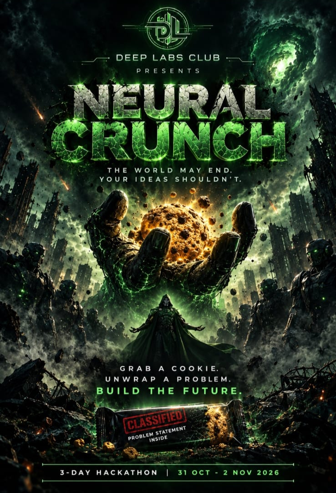

# Neural Crunch 2026 🍪

<p align="center">
  
</p>

Welcome to the official **Neural Crunch** open-source submission repository! Hosted by **DeepLabs**, the AI/ML Club of IIIT Raichur, this 48-hour hackathon challenges participants to bridge classroom theory with practical, industry-oriented engineering by building end-to-end technology solutions.

Use this repository to submit your team's project code, documentation, architecture diagrams, and working prototypes for evaluation by our esteemed jury.

---

## 📌 About the Event
* **Event:** Neural Crunch (48-Hour AI/ML Hackathon)
* **Organized By:** DeepLabs, AI/ML Club, IIIT Raichur
* **Dates:** 31 October – 2 November 2026
* **Venue:** Auditorium, IIIT Raichur

---

## 🛠️ Project Pipeline Expectations
Participants are encouraged to work through a rigorous, real-world development pipeline:
1. **Problem Identification & Scoping:** Defining the core problem statement and target impact.
2. **Data Preparation:** Data collection, cleaning, preprocessing, and exploratory data analysis (EDA).
3. **AI/ML Model Development:** Training, fine-tuning, and evaluating machine learning or deep learning architectures.
4. **Full-Stack Integration:** Integrating models with frontend interfaces, robust backend services, and database layers.
5. **Testing & Documentation:** Debugging, system verification, and clean repository documentation.

---

## 📂 Repository & Submission Structure

To ensure smooth evaluation, please structure your team's repository according to the template below:

```text
├── backend/          # API services, server code, and DB integrations
├── frontend/         # Web/mobile UI or client-side application
├── models/           # Trained weights, notebooks, or ML pipeline scripts
├── data/             # Sample datasets or preprocessing instructions (avoid large raw files)
├── docs/             # Architecture diagrams, API specs, and presentation slides
└── README.md         # Comprehensive project guide (instructions below)
```
---

## How to Submit Your Project

To submit your project for the hackathon jury evaluation, follow these steps:

1. **Create Your Team Repository:** 
   * Create a public repository on your team lead's GitHub account (or under a team organization).
   * Name your repository clearly (e.g., `neural-crunch-<team-name>`).

2. **Organize Your Code:**
   * Ensure your code follows the recommended folder structure (`backend/`, `frontend/`, `models/`, etc.).
   * Fill out your repository's root `README.md` with your project title, team members, roll numbers, architecture details, and local setup instructions.
   * **If your team has deployed your application, make sure to prominently feature your **Live Demo URL** right at the top of your repository's `README.md` file.**

3. **Submit the Link:**
   * Drop your public GitHub repository link into the **official Neural Crunch submission form/portal** provided by DeepLabs before the 48-hour build window closes.
   * *Make sure your repository is public and accessible so the jury and mentors can review your code and documentation.*
